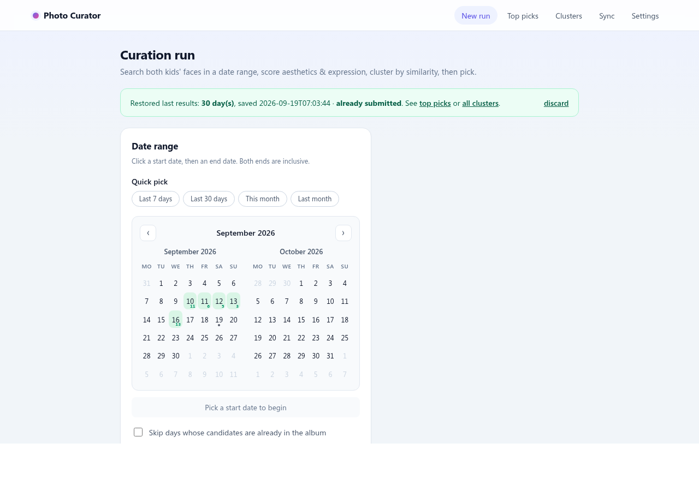

# Photo Curator

[中文说明](README.zh-CN.md)

A self-hosted workflow that turns tens of thousands of family photos in
[Immich](https://immich.app) into a small, hand-picked album of the moments
worth sharing — automatically ranked, finally chosen by you.



## Why

Phone cameras produce tens of thousands of frames: blurry duplicates,
near-identical bursts, and "what was this even for" photos. Google Photos'
highlight reels don't know our kids, don't rank smiles the way we do, and —
for a lot of the families we share with — aren't reachable at all. We wanted a
pipeline that:

1. **knows whose faces matter** (our kids first, the rest of the family second),
2. **picks one great frame per moment**, not 30 similar ones,
3. **keeps a human in the loop** — the tool proposes, we submit,
4. **publishes to a gallery family members in China can actually open** — no
   Google account, no VPN.

## How it works

You run an analysis over a date range (pick it on a calendar). For each day:

- **Search** — every photo Immich has face-tagged as one of your *primary
  people* (your kids) on that date becomes a candidate.
- **Score** — three local ML models (nothing leaves your machine):
  - *Quality*: MUSIQ no-reference image quality (sharpness, exposure, composition)
  - *Expression*: MediaPipe Face Landmarker reads eyes-open, smile, and
    camera-facing per face; kids looking at the camera and smiling score highest
  - *Togetherness*: a person-boost for shots with multiple family members, plus
    a family-expression boost for group warmth
- **Cluster** — CLIP embeddings group near-duplicate shots into *moments*, so a
  burst of 30 frames collapses to its best one (cluster-top bonus).
- **Rank & select** — `total = w_q·quality + w_e·expression + person_boost +
  family_boost + cluster_top_bonus`. Per-day defaults pre-select the top picks;
  every weight and threshold is editable in the settings UI.

Then you **review**: a per-day top-picks page, an all-clusters page, and deep
per-photo views. Tick what you like, submit — selections are added to your
Immich album. The album is the source of truth.

### Re-scoring, not re-running

All expensive per-photo features (quality, expression, CLIP vectors) are
cached to disk keyed by asset. Tuning the weights — "expression matters more,
cluster tighter" — triggers an instant re-score over the cache; no GPU
re-inference, and your manual selections survive. Settings changes that
outdate a run show a "re-score to apply" banner.

### Publishing to a shareable gallery (optional)

A built-in **Sync** page reconciles the album into a
[Pixtale](https://github.com/aslost/pixtale) gallery: live progress, dry-run
preview, opt-in deletes, and a storage-backend picker (Pixtale's S3 storage —
we use a Qiniu Kodo bucket, which is why this setup works well for family in
mainland China). Pixtale generates its own previews/thumbnails and serves a
lightweight public or password-protected web gallery. Photos already in the
gallery are deduped by content hash, so syncing is safe to re-run any time.

## Privacy

All analysis runs locally: candidate search talks only to *your* Immich server,
and scoring only to CPU-resident models. Photos leave your machine only if you
choose the optional pixtale sync, to a gallery and storage you operate. No
third-party API keys, no telemetry.

## Setup

Requires Python ≥ 3.13 and a running Immich server with face recognition
enabled and your family's people created (the settings page browses them by
name — person UUIDs never need to be typed by hand).

```bash
# 1. Install dependencies (uv)
uv sync

# 2. Face-landmark model (MediaPipe's public model zoo)
curl -L -o face_landmarker.task \
  https://storage.googleapis.com/mediapipe-models/face_landmarker/face_landmarker/float32/1/face_landmarker.task

# 3. Configure — copy the example and fill in your values
cp config.local.json.example config.local.json

# 4. Run
uv run python daily_highlights.py     # UI on http://localhost:5724
```

Everything site-specific lives in `config.local.json` (gitignored) or the
matching environment variables (which win): Immich URL / API key / album ID,
the face-set seed lists, timezone, and the pixtale endpoint. The first
curation run pays a one-time ~10 s ML import; each job afterwards runs in a
short-lived worker subprocess so gigabytes of model memory return to the OS
when it exits.

Headless mode is available for cron-style monthly runs:

```bash
uv run python daily_highlights.py --month 2026-04 --skip-in-album
```

## Tuning what "best" means

`/settings` exposes the whole ranking function: weight of quality vs
expression vs person boost, per-component expression weights (eyes / smile /
facing, separately for primary and family faces), cluster similarity
threshold, max moments per day, and the default-selection floor. If the
tool's taste and your taste diverge, that's a settings conversation, not a
code change.

## License

[MIT](LICENSE)
