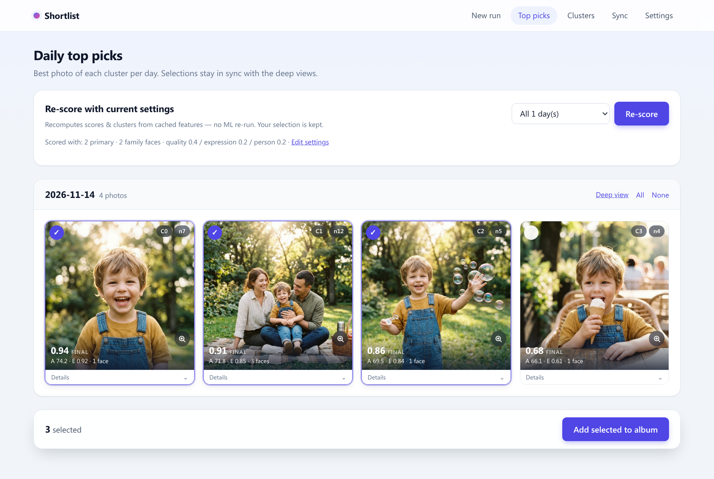
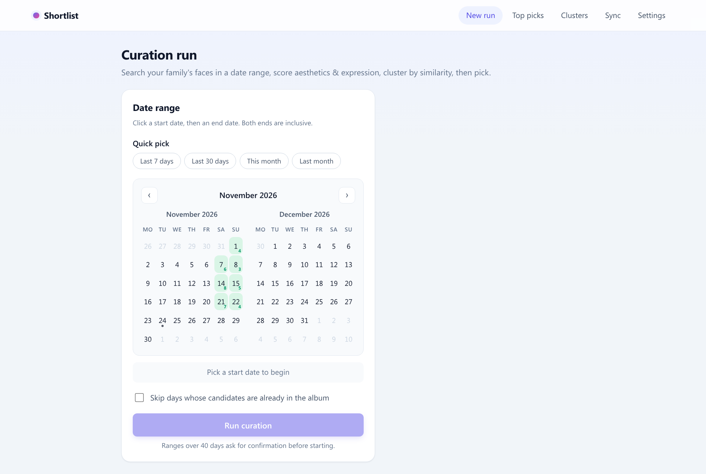

# Shortlist

**Immich 家庭照片自动精选——最终由你拍板。**
[English](README.md)

Shortlist 是一个 **Immich 的配套应用**：把一个月里成千上万张照片按天排名成
一份候选精华，把勾选框交给你。它运行在你现有的 Immich 旁边（不替代、不 fork），
你勾选后**回写进一个 Immich 相册**——还能一键同步到可分享的
[Pixtale](https://github.com/aslost/pixtale) 相册。



## 为什么要做这个

Immich 擅长"存好、找得到"，前提是你已经知道自己要找哪张。但它回答不了那个
真正让人头疼的问题：

> *"这个月给孩子拍了 3000 张，到底哪 20 张值得留下、值得分享？"*

Immich 能去重、能识别人脸，却不会按"谁在笑、谁看镜头"给连拍排序，不会把 30 张
几乎一样的合并成一个瞬间，也不会丢给你一份能直接勾选的候选清单。Google 相册倒是
有"回忆"，但它的推荐不认识**我们的**孩子、不按我们在乎的标准排；而且更现实的是——
我们最想分享的那些国内家人，**没有 Google 账号和梯子根本打不开**。

于是我们补上了这缺失的一层：**自动精选，人来拍板**。机器负责枯燥的部分
（检索、打分、聚类、提名），你负责唯一只有你能做的部分（挑出有含义的那几张）。
结果回流进 Immich，Immich 仍是唯一的事实来源——精选生成的相册就是一个普通
Immich 相册，什么都不会被困住。想让亲戚看看时，一键同步到自建的 Pixtale 相册，
发一个在上海、深圳都能直接打开的链接。

具体来说，它要做到：

1. **认得谁最重要**——先盯自家孩子的脸，再算上其他家人；
2. **每个瞬间只提名一张最好的**，而不是 30 张雷同的；
3. **始终由你拍板**——它提名、你确认，然后回写 Immich；
4. **发布到国内家人能直接打开的相册**——不用 Google、不用梯子。

## 它是怎么工作的

在日历上选一个日期区间：



逐日分析：

- **检索**——把当天被 Immich 标记为"主要人物"（自家孩子）出现过的照片，
  全部列为候选。
- **打分**——三个本地模型（数据不出本机）：
  - *画质*：MUSIQ 无参考图像质量（清晰度、曝光、构图）
  - *表情*：MediaPipe 人脸关键点，逐脸读出"睁眼 / 微笑 / 看镜头"；
    孩子笑着看镜头的分最高
  - *同框*：多个人物的合照有加权，家庭群的温馨表情再加一层
- **聚类**——用 CLIP 向量把连拍的近似帧聚成"一个瞬间"，一组里只留最好的那张。
- **排名与预选**——
  `总分 = 画质权重·画质 + 表情权重·表情 + 人物加权 + 家庭加权 + 组内最优奖励`。
  每天按默认阈值预先勾好顶部照片；每个权重、每个阈值都能在设置页里调。

然后你来**复核**：每日精选页、全部瞬间页、逐张深看页。勾选喜欢的，提交——
选中的照片会被加入 Immich 相册。这个相册就是唯一的事实来源。

### 重打分，而不是重跑

每张图昂贵的特征（画质、表情、CLIP 向量）都按资产缓存到磁盘。
调权重时——"表情更重要一点、聚得更紧一点"——直接在缓存上秒级重算，
不重新跑模型，你的手动勾选也会保留。若设置已经和当前分数不符，页面会提示"重新打分"。

### 发布成可分享的相册（可选）

内置的**同步 (Sync)** 页会把相册内容对齐到一个
[Pixtale](https://github.com/aslost/pixtale) 相册：实时进度、试运行预览、
可选删除、以及存储后端选择（Pixtale 的 S3 存储——我们用的是**七牛云 Kodo**，
正因如此这套方案在国内家人那边访问体验很好）。Pixtale 自己生成预览和缩略图，
提供一个轻量的公开或带密码的网页相册。已在相册里的照片按内容哈希去重，
所以同步随时可以放心重跑。

## 隐私

所有分析都在本地跑：候选检索只连**你自己的** Immich 服务器，打分只用到常驻 CPU 的模型。
照片只有在你要启用可选的 Pixtale 同步时才会离开本机，去向是你自己运营的相册和存储。
没有第三方 API key，没有任何遥测上报。

## 安装

需要一个已开启人脸识别、且已建好家人人物（people）的 Immich 服务器
（`/settings` 设置页能按名字浏览和勾选人物——**不用手抄任何 UUID**）。

### 方式一：Docker Compose（推荐）

```bash
git clone https://github.com/cxcxcxcx/immich-shortlist.git
cd immich-shortlist
# 编辑 docker-compose.yml，填入 IMMICH_URL、IMMICH_API_KEY、IMMICH_ALBUM_ID 和 LOCAL_TZ
docker compose up -d --build
```

打开 `http://localhost:5724`，先到 **Settings** 页面选好主要人物和其他家人，
就能开始第一次精选。`./data` 挂载卷会在容器重建后保留你的参数、特征缓存、断点记录
和已下载的模型权重。镜像默认使用 CPU 版 PyTorch，并已内置 MediaPipe 的
`face_landmarker.task` 模型。

### 方式二：本地 Python（`uv`）

需要 Python ≥ 3.13：

```bash
# 1. 安装依赖
uv sync

# 2. 配置——复制示例并填入你的值
cp config.local.json.example config.local.json

# 3. 运行（首次使用会自动下载 face_landmarker.task 模型）
uv run python daily_highlights.py     # 界面在 http://localhost:5724
```

所有跟具体部署相关的值都放在 `config.local.json`（已被 gitignore）或对应的环境变量里
（环境变量优先）：Immich 地址 / API key / 相册 ID、人物名单、时区、可选的 Pixtale 地址。
第一次跑精选会付一次约 10 秒的模型加载；此后每个任务都在一个用完即退的子进程里跑，
几 GB 的模型内存会在任务结束时还给操作系统。

也可以无界面地按月跑（适合定时任务）：

```bash
uv run python daily_highlights.py --month 2026-04 --skip-in-album
# 或通过 Docker：
docker compose run --rm shortlist python daily_highlights.py --month 2026-04 --skip-in-album
```

## 调教它眼中的"最好"

`/settings` 把整个排名公式都摊开了：画质 vs 表情 vs 人物加权的比重、
表情各分量的权重（睁眼 / 微笑 / 看镜头，主要人物和其他家人可分别设置）、
聚类的相似度阈值、每天最多留几个瞬间、预选的分数下限。
如果它的品味和你的对不上，那是设置页里能谈的事，不用改代码。

## 关于维护

Shortlist 最初是为自家 Immich 照片库写的自用工具，按 MIT 协议原样开源分享。
欢迎提 Issue 和 PR，但维护节奏会以自家需求为主。

## 许可

[MIT](LICENSE)
